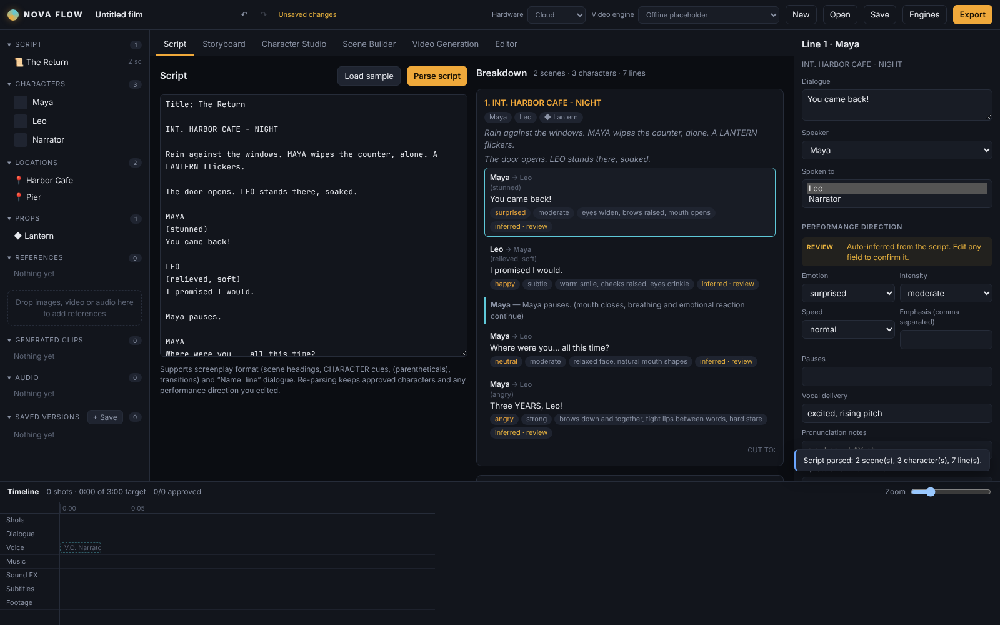
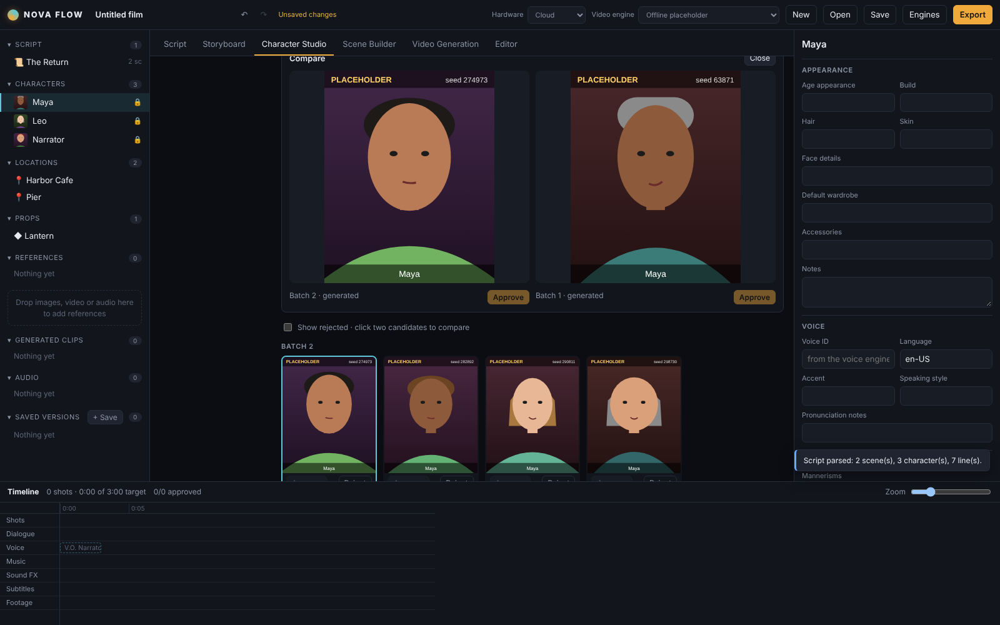
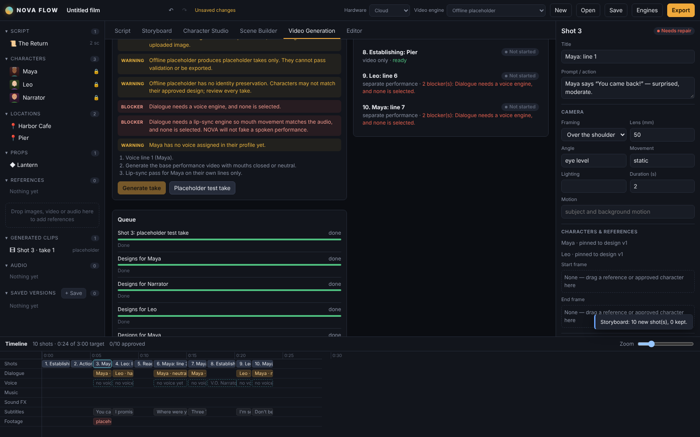

# NOVA FLOW

A desktop AI filmmaking studio. You write the script, design and approve the cast, direct every line as a performance, plan the camera, generate and review shots, edit, and export.

The rule NOVA is built around: **every spoken line is a character performance, not audio laid over video.** When the selected engines cannot do what a shot asks for, NOVA says so instead of pretending.



## Stack

- **Electron** desktop shell (context-isolated preload; project files saved as `.novaflow` JSON)
- **React 18 + TypeScript**, bundled with **Vite**
- **Zustand** for app state with undo/redo
- **Vitest** for the core logic

All production logic lives in `src/core/` as plain TypeScript with no UI or Electron dependency, so it can be tested on its own and later moved to a worker or backend.

## Running it

```bash
npm install
npm run dev            # browser preview at http://localhost:5173 (autosaves to the browser)
npm run dev:desktop    # Electron window against the Vite dev server
npm run desktop        # production build, then Electron
npm test               # core test suite
npm run build          # typecheck + renderer build + Electron main build
```

## What works now

**Workspace shell.** Library sidebar (script, characters, locations, props, references, generated clips, audio, saved versions), toolbar (project name, undo/redo, save state, hardware profile, video engine, engines, export), six workspace modes (Script, Storyboard, Character Studio, Scene Builder, Video Generation, Editor), a context inspector, and a shot timeline with Shots, Dialogue, Voice, Music, Sound FX, Subtitles and Footage tracks. Drag images, video or audio onto the library to add references, then drag a reference or an approved character onto a shot's start or end frame.

**Script parsing** (`src/core/script/`). Screenplay format (scene headings, CHARACTER cues, extensions such as V.O., parentheticals, transitions) and simple `Name: line` dialogue, mixed freely. It extracts scenes, locations, characters, dialogue, beats such as "Maya pauses", props, and voice-over. For every line it records the speaker, who is spoken to, and what everyone else in the scene is doing (listening, reacting, silent). Each line gets a performance direction: emotion, intensity, speed, pauses, emphasis, vocal delivery, pronunciation, expression before, during and after, eyes, head, posture and gesture. Inferred directions are flagged for review until the director edits them. Ids are deterministic, so re-parsing keeps approved characters and edited performances.

**Character Studio** (`src/core/characters/`). Generate 4, 6 or 8 candidates per round, upload references, compare two side by side, reject or restore, approve, and lock. Rules enforced in the core:
- A character with no approved design cannot be used in production.
- Regenerating only adds candidates. It never replaces the approved design.
- A locked identity cannot be re-approved until it is explicitly unlocked, and that is logged.
- Shots pin the reference ID and version they were planned with. If a character is re-approved later, affected shots warn and must be re-pinned by hand.
- An approved reference image guides generation. It is not a trained identity model, and the UI says so.

**Generation engines** (`src/core/engines/`). Every engine declares its capabilities: video, native audio, speech, lip-sync, emotion and head-motion control, multi-speaker, reference images, identity preservation, start/end frames, max duration, aspect ratios and languages. The planner checks each shot against them and returns a route (`native_av`, `separate_performance` or `video_only`), the steps, and every blocker or warning. Dialogue with no capable engine is blocked ("NOVA will not fake a spoken performance"). Multi-speaker shots on engines that cannot handle them are split into per-speaker lip-sync passes.

The included engines:
- **Offline placeholder**: draws labelled placeholder portraits and makes placeholder takes so the workflow can be tested without keys. Its output can never pass validation or be exported.
- **Cloud video, voice and lip-sync slots**: report "not configured" until a provider adapter is written.

**Lip-sync validation** (`src/core/validation/`). Every take gets a report covering real footage, correct speaker, mouth-to-audio alignment, no mouth movement on another character's line, emotion consistency, blinking and breathing, no frozen face or jaw, audio/video drift, and language and pronunciation. Checks come from engine metadata (objective, and cannot be overridden), from an analyzer (an interface, none bundled yet), or from the director's manual review (recorded as manual). A shot only becomes **Approved** when an approved take passes every check. A video file existing is never enough.

**Export check.** Lists unapproved shots, placeholder or missing media, frame-rate mismatches, voice-over with no audio, and orphaned shots. Final rendering and encoding are not implemented yet, and the export check says so.




## Not built yet

- Real provider adapters for image, video, voice and lip-sync. These depend on which providers and API keys you choose.
- A performance analyzer for automatic mouth, face and blink checks.
- Audio mixing of several voice lines into one track, frame extraction for "continue from last frame", and the final render and encode.
- Identity training (for example LoRA). This is a separate pipeline that needs compatible hardware and permitted training data.

## Layout

```
electron/            main process + preload (file dialogs, atomic saves)
src/core/            domain model and rules (no UI)
  script/            parser + performance inference
  characters/        Character Studio identity rules
  storyboard/        script -> shots, duration estimates
  engines/           engine interface, registry, planner, placeholder + cloud slots
  validation/        lip-sync validation, shot status, take approval
  generation.ts      candidate and take generation following the plan
  project.ts         project creation, script merge, versions, export check
src/state/           Zustand store (undo/redo, autosave, jobs) and actions
src/ui/              React workspace shell, inspector, timeline, workspaces
tests/               Vitest suites for parser, characters and the pipeline
```

NOVA FLOW's workflow is inspired by AI filmmaking tools in general. Its interface, code and branding are original.
